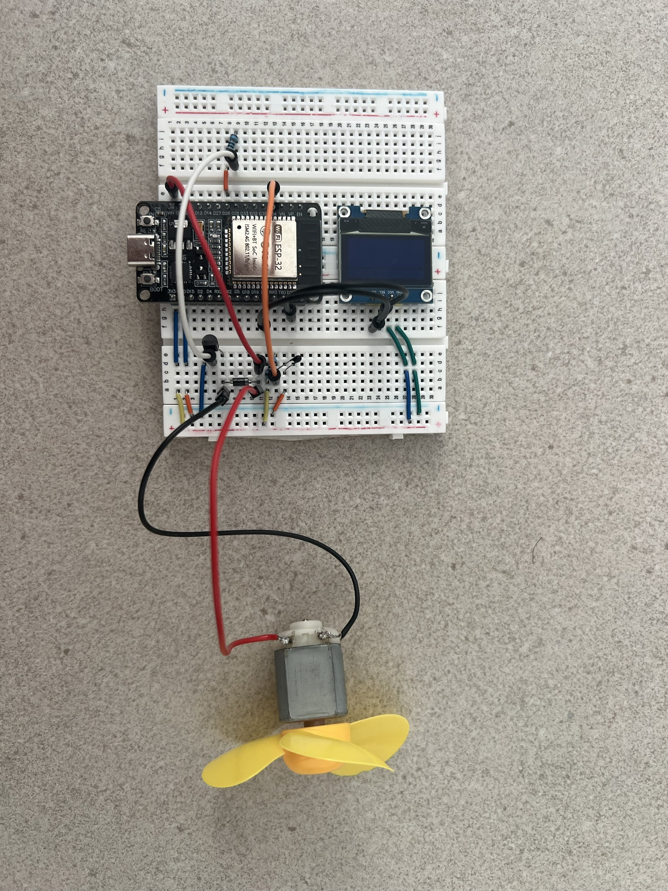
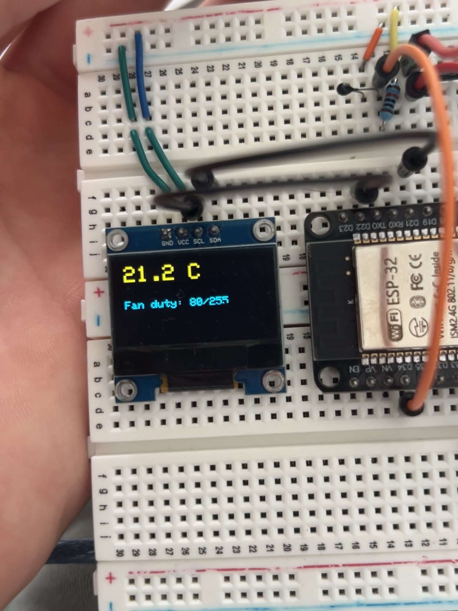

# Thermistor-Controlled Fan

An ESP32 project that reads an NTC thermistor, converts the reading to
temperature with the beta equation, and drives a 5V DC fan with a PWM
ramp through a transistor stage. An OLED shows live temperature and
fan duty.

## How it works

- A 10kΩ NTC thermistor forms a voltage divider with a fixed 10kΩ
  resistor. The midpoint feeds GPIO34 (ADC1, input-only).
- Raw ADC counts are converted to voltage, then resistance, then
  temperature using the beta equation (`B = 3950`).
- Fan speed ramps linearly between 27°C (idle floor, duty 80/255) and
  45°C (full speed, duty 255/255), instead of jumping between fixed
  on/off thresholds.
- A PN2222 transistor switches the fan's ground side; the ESP32 can't
  source enough current to drive the fan directly from a GPIO pin.
- A flyback diode sits across the fan terminals (cathode to +5V) to
  absorb the voltage spike when the motor's magnetic field collapses
  on every PWM switching cycle — without it, the spike would eventually
  destroy the transistor.
- The fan runs off the 5V/VIN rail, not 3V3 — it was confirmed too
  weak to spin reliably at 3V3 during testing.

## What went wrong, and how it got fixed

The first version of this project read **-46.5°C** and reported
"Sensor fault" on the display, while the thermistor itself got
noticeably hot. That combination meant the divider was wired with a
short or near-short, not just a bad calibration constant — a thermistor
shouldn't heat up from the small current in a correctly-wired divider,
and a resistance that low doesn't correspond to any real temperature.

The fix had two parts:
1. **Real fault detection in code.** The original sketch had no check
   for an implausible ADC reading, so a short or open circuit was
   silently converted into a nonsense temperature instead of being
   flagged. The rebuilt version checks for near-0 or near-max raw ADC
   values and forces the fan to full speed with a "SENSOR FAULT"
   message instead of trusting garbage data.
2. **Divider orientation and wiring check.** The fixed resistor sits
   on the 3V3 side, the thermistor on the GND side, with GPIO34 reading
   the junction. Getting this order backwards, or a cold solder joint
   shorting adjacent points, produces exactly the symptom seen here.

Readings now land at a plausible room temperature (≈21°C) with no
fault condition, and the fan duty cycle matches what the code
predicts for that temperature — confirmation the fix held, not just
a one-off good reading.

## Parts

| Part | Notes |
|---|---|
| ESP32 DevKit (WROOM-32) | |
| NTC thermistor, 10kΩ, B=3950 | |
| Fixed resistor, 10kΩ | Divider pair with the thermistor |
| PN2222 transistor | Fan ground-side switch |
| 1kΩ resistor | Base resistor for the PN2222 |
| Flyback diode (1N400x) | Across fan terminals, cathode to +5V |
| 5V DC fan | Powered from VIN, not 3V3 |
| SSD1306 OLED, 128x64, I2C | SDA 21 / SCL 22 |

## Wiring

**Thermistor divider:**
3V3 → 10kΩ resistor → junction (→ GPIO34) → thermistor → GND

**Fan driver:**
GPIO26 → 1kΩ resistor → PN2222 base
PN2222 emitter → GND
PN2222 collector → fan (−)
Fan (+) → 5V/VIN
Flyback diode in parallel across the fan terminals, cathode (banded
end) on the +5V side

**OLED:**
VCC → 3V3, GND → GND, SDA → GPIO21, SCL → GPIO22

All grounds (ESP32, transistor emitter, fan supply, OLED) share one
common ground.

## Status

Working. Idle-floor duty (80/255) confirmed matching the code's
behavior below the 27°C ramp threshold at a measured room temperature
of 21.2°C. Full ramp behavior (27–45°C) not yet tested against an
actual heat source — next step is to verify the ramp with a controlled
heat source (hair dryer at a safe distance, or similar) rather than
assuming the linear interpolation is correct just because the idle
case is.

## Lesson learned

A "sensor fault" symptom paired with a physically hot sensor is a
wiring short, not a calibration problem — fix the circuit before
touching the math. The code fix (explicit fault detection) is what
should have existed from the start; it would have surfaced the real
cause immediately instead of producing a confusing -46.5°C reading
that looked like a bad formula.
